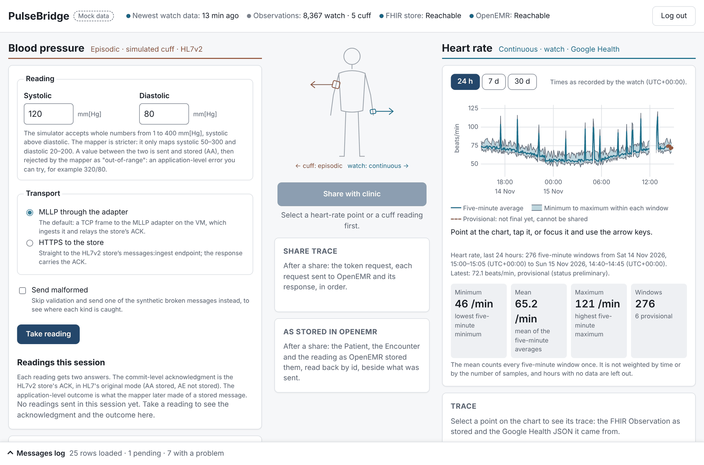
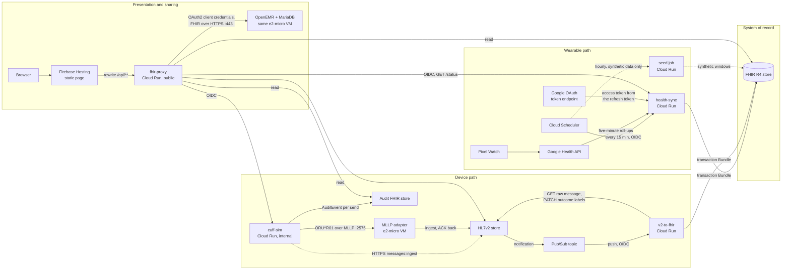
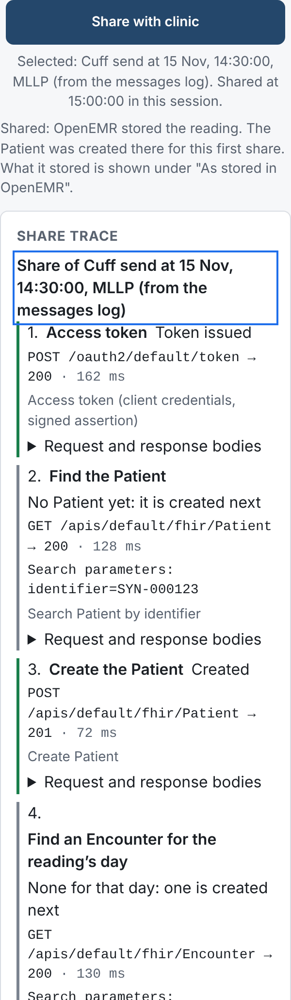

# PulseBridge

**Consumer and device health data, made standards-compliant, landed in a clinic's EMR, with all
the infrastructure as code.**

PulseBridge is a single-patient personal health record (PHR) on Google Cloud. It reads heart rate
from a Pixel Watch through the Google Health API and blood pressure from a simulated cuff that
speaks **HL7v2** over **MLLP**, stores both as **FHIR R4** in a Cloud Healthcare API FHIR store,
charts them on a one-page dashboard, and shares a selected reading with a clinic by writing it
to **OpenEMR**'s FHIR API with an OAuth2 client. Every cloud resource is created by **Terraform**,
and the stack costs close to nothing when idle.



*The dashboard in mock mode (synthetic data, no server). See [Status](#status) for what has and
has not run against real services.*

## What to read first

If you have ten minutes, read these. They are the parts written by hand on purpose, rather than
delegated to a managed mapping service:

1. **The HL7v2-to-FHIR mapping**: [`services/v2-to-fhir/v2_to_fhir/mapping.py`](services/v2-to-fhir/v2_to_fhir/mapping.py),
   with its field-by-field table in [`services/v2-to-fhir/README.md`](services/v2-to-fhir/README.md#the-mapping).
   An ORU^R01 (MSH, PID, OBR, two OBX) becomes a blood-pressure panel Observation, with every
   refusal named.
2. **The Google-Health-to-FHIR mapping**: [`libs/pulsebridge_fhir/pulsebridge_fhir/google_health.py`](libs/pulsebridge_fhir/pulsebridge_fhir/google_health.py)
   and the resource builders beside it ([`resources.py`](libs/pulsebridge_fhir/pulsebridge_fhir/resources.py),
   [`bundle.py`](libs/pulsebridge_fhir/pulsebridge_fhir/bundle.py)). Five-minute roll-ups become
   heart-rate Observations written idempotently; the design notes are in
   [`libs/pulsebridge_fhir/README.md`](libs/pulsebridge_fhir/README.md#design-decisions).
3. **The Terraform modules**: [`infra/modules/`](infra/modules/), one README each, composed once in
   [`infra/envs/_stack`](infra/envs/_stack/) and deployed by the runbook in
   [`infra/envs/README.md`](infra/envs/README.md).

## Architecture



- **Wearable path.** Cloud Scheduler calls `health-sync` every 15 minutes. It asks the Google
  Health API for five-minute heart-rate roll-ups (minimum, average, maximum), maps each window
  to a FHIR `Observation` with a `Provenance`, and writes a transaction `Bundle` of conditional
  updates, so a repeated window rewrites the same Observation. It gets each access token from
  Google's OAuth token endpoint with the stored refresh token. In a synthetic deployment (the
  dev default) there is no `health-sync`: Scheduler runs the seeder job (`services/seed`) hourly
  instead, which writes invented windows (dashed in the diagram).
- **Device path.** The cuff simulator builds an HL7v2 ORU^R01 with `hl7apy`, sends it over MLLP
  to Google's MLLP adapter on the VM (or straight to the store over HTTPS), and returns the store's
  ACK. The HL7v2 store announces each stored message on Pub/Sub; `v2-to-fhir` fetches the raw
  message, maps it, writes the Observation, and labels the message with its outcome. Every send
  attempt, including rejected and unacknowledged ones, is an `AuditEvent` in a separate audit
  store that the simulator can write but that holds no health data.
- **Presentation.** The page and `fhir-proxy` share one origin through a Hosting rewrite.
  `fhir-proxy` is the only public service: it checks a shared reviewer password, issues an
  8-hour signed token, exposes a narrow read API with its own CapabilityStatement, forwards cuff
  readings, asks `health-sync` for its status (real data) for the status strip, and runs the
  share.
- **Sharing.** The share searches for or creates the Patient and an Encounter in OpenEMR, creates
  the Observation, and reads all three back for the "As stored in OpenEMR" panel. OpenEMR's
  screens are not exposed to the internet; only Cloud Run's subnet reaches the VM, which has no
  public IP.

The Terraform that builds this: `project-base` (APIs, VPC, firewall, Artifact Registry),
`identity` (service accounts, secrets), `healthcare` (dataset, FHIR and HL7v2 stores, Pub/Sub),
`ingestion` (health-sync or the seeder, v2-to-fhir, Scheduler, alerts), `edge-vm` (the e2-micro
and the MLLP adapter), `openemr` (OpenEMR on that VM and its OAuth client registration) and `phr`
(Hosting, fhir-proxy, cuff-sim).

## Standards map

| Standard | What PulseBridge uses | Where in the code |
| --- | --- | --- |
| FHIR R4 resources | `Patient`, `Device`, `Observation`, `Provenance`, transaction `Bundle`; `AuditEvent` for cuff send attempts; `Encounter` in OpenEMR; `OperationOutcome` errors; a `CapabilityStatement` for the proxy | [`libs/pulsebridge_fhir/`](libs/pulsebridge_fhir/README.md), [`services/fhir-proxy/fhir_proxy/capability.py`](services/fhir-proxy/fhir_proxy/capability.py) |
| FHIR profiles | R4 Vital Signs: `heartrate` and `bp`, category `vital-signs`; deviations documented | [`libs/pulsebridge_fhir/README.md`](libs/pulsebridge_fhir/README.md#conformance-to-the-r4-vital-signs-profiles) |
| FHIR writes | conditional update (`PUT Observation?identifier=...`) for idempotency; conditional create (`ifNoneExist`) for Patient and Device from ingest; one setup write of the full Patient | [`libs/pulsebridge_fhir/pulsebridge_fhir/bundle.py`](libs/pulsebridge_fhir/pulsebridge_fhir/bundle.py) |
| LOINC | `8867-4` heart rate (min `96935-2`, max `55426-1` as components); `85354-9` BP panel; `8480-6` systolic; `8462-4` diastolic | [`libs/pulsebridge_fhir/pulsebridge_fhir/codes.py`](libs/pulsebridge_fhir/pulsebridge_fhir/codes.py) |
| UCUM | `/min`, `mm[Hg]` | the same, and OBX-6 in the HL7v2 builder |
| FHIR validation | the official HL7 FHIR Validator over example resources, in CI | [`scripts/fhir-validate.sh`](scripts/fhir-validate.sh), `make fhir-validate` |
| HL7v2 2.5.1 message | ORU^R01 with MSH, PID (PID-3 identifier and authority), OBR (OBR-4 `85354-9`), two OBX (OBX-3 LOINC, OBX-5 value, OBX-6 unit, OBX-11 status, OBX-14 time with offset) | [`libs/pulsebridge_hl7v2/pulsebridge_hl7v2/oru.py`](libs/pulsebridge_hl7v2/pulsebridge_hl7v2/oru.py), [`libs/pulsebridge_hl7v2/README.md`](libs/pulsebridge_hl7v2/README.md#what-the-builder-writes-hl7-v251) |
| HL7v2 acknowledgment | the store's ACK in original mode: `AA` stored, `AE` rejected with MSA-3; "no acknowledgment" as its own outcome; labelled commit-level, with the mapper's result as the application-level outcome (modelled on enhanced mode, MSH-15/16) | [`libs/pulsebridge_hl7v2/pulsebridge_hl7v2/ack.py`](libs/pulsebridge_hl7v2/pulsebridge_hl7v2/ack.py), [`services/cuff-sim/README.md`](services/cuff-sim/README.md#mllp) |
| MLLP | start block `0x0B`, end `0x1C 0x0D`, one frame per connection; Google's mllp-adapter on the VM | [`libs/pulsebridge_hl7v2/pulsebridge_hl7v2/mllp.py`](libs/pulsebridge_hl7v2/pulsebridge_hl7v2/mllp.py), [`services/cuff-sim/cuff_sim/mllp_client.py`](services/cuff-sim/cuff_sim/mllp_client.py) |
| HL7v2 parsing | `hl7apy` builds, validates and parses; the raw ER7 is mapped, not the store's `parsedData` | [`services/v2-to-fhir/README.md`](services/v2-to-fhir/README.md#input-the-raw-er7-not-parseddata) |
| OAuth 2.0, Google | authorization code flow with PKCE (S256), `state`, loopback redirect, offline access; refresh tokens in Secret Manager | [`scripts/connect-google-health/`](scripts/connect-google-health/README.md) |
| OAuth 2.0, OpenEMR | client credentials grant with `private_key_jwt` (RS384 signed assertion), scoped `system/*` tokens; client registered on the VM | [`services/fhir-proxy/fhir_proxy/share/oauth.py`](services/fhir-proxy/fhir_proxy/share/oauth.py), [`infra/modules/openemr/README.md`](infra/modules/openemr/README.md) |
| OIDC service-to-service | Scheduler, Pub/Sub push and fhir-proxy call Cloud Run with Google-signed identity tokens | [`infra/modules/identity/README.md`](infra/modules/identity/README.md#who-invokes-whom-decision-d10) |
| Workload Identity Federation | GitHub Actions to the deployer, restricted to one repository by numeric ID; no keys | [`infra/bootstrap/wif.tf`](infra/bootstrap/wif.tf) |

## Repository layout

```text
infra/
  bootstrap/        one-time: project, state bucket, deployer, Workload Identity Federation, Firebase
  modules/          project-base, identity, healthcare, ingestion, edge-vm, openemr, phr
  envs/             _stack (the composition), dev and prod roots, and the runbook (README.md)
libs/
  pulsebridge_fhir/   FHIR R4 builders and the Google Health mapping (no network)
  pulsebridge_hl7v2/  HL7v2 ORU^R01 builder, ACK parser, MLLP framing (hl7apy)
  pulsebridge_gcp/    thin Cloud Healthcare API client
services/
  health-sync/      Google Health to FHIR (Cloud Run)
  v2-to-fhir/       HL7v2 store to FHIR (Cloud Run, Pub/Sub push)
  cuff-sim/         the cuff simulator backend (Cloud Run, internal only)
  fhir-proxy/       the dashboard's only backend: login, read API, share to OpenEMR
  seed/             the synthetic-data seeder (Cloud Run job)
scripts/
  connect-google-health/   connect your own Google Health account (OAuth, PKCE)
web/                the dashboard: Vite and TypeScript, with a mock client
docs/               the setup guide, spike notes, the work plan
tests/tooling/      repository-wide checks (Makefile, CI, images, these docs)
```

## Quick start

The full walk-through, from a fresh clone to a running stack and back to nothing, is
**[docs/setup.md](docs/setup.md)**. In short:

1. Run [`infra/bootstrap`](infra/bootstrap/README.md) once with your own Google login: it
   creates or adopts a project, a state bucket, a deployer service account and Workload Identity
   Federation.
2. Use `infra/envs/dev`, which defaults to **synthetic data** (a `SYN-` patient): no Pixel Watch
   and no Google Health OAuth app needed; the cuff simulator works end to end.
3. Follow the [runbook](infra/envs/README.md#the-runbook): targeted applies, secret values, the
   VM's first boot, the image build, the first apply with ingest off, the first seeding, the
   second apply with ingest on, the page deploy.

To see the dashboard right now with no cloud at all:

```bash
cd web
npm ci
npm run dev       # mock mode on http://localhost:5173 (any non-empty password logs in)
```

## OpenEMR chart: screenshot to come

> **Placeholder.** Reviewers cannot open OpenEMR themselves (its screens are deliberately not
> exposed, decision D13), so this section is meant to show a shared reading in the real OpenEMR
> chart. It needs a deployed stack and has not been captured yet.
>
> How it will be captured, **with synthetic data only**:
>
> 1. Deploy `dev` with `use_synthetic_data = true` (patient `SYN-...`, name Synthetic / Demo),
>    following [docs/setup.md](docs/setup.md).
> 2. In the dashboard, take a cuff reading, wait for the outcome "accepted", select it and
>    **Share with clinic**; share one final heart-rate point too.
> 3. Set `enable_iap_ssh = true` and apply. Your account needs `roles/iap.tunnelResourceAccessor`,
>    `roles/compute.osAdminLogin`, and `roles/iam.serviceAccountUser` on the VM's service account
>    ([edge-vm README](infra/modules/edge-vm/README.md#looking-at-the-vm-without-public-access)).
>    Then open a temporary tunnel through IAP to OpenEMR's HTTPS port, which the VM publishes on
>    every one of its interfaces (`openemr_https_port`, 443 by default):
>    `gcloud compute ssh <name_prefix>-edge-vm --zone <zone> --tunnel-through-iap --project <project-id> -- -L 8443:localhost:<openemr_https_port>`
>    (not yet tried).
> 4. Open `https://localhost:8443`, accept the self-signed certificate and log in as `admin`. The
>    password is the `openemr-admin-password` secret's value: open it in the Google Cloud console
>    (Secret Manager, the secret, the version's "View secret value") rather than printing it in a
>    terminal, where it would land in scrollback and logs. Open the synthetic patient
>    (Synthetic / Demo) and the **Vitals** of the shared day.
> 5. Capture the vitals with the reading visible. Check the image shows only the synthetic
>    patient, no address bar or host name, and no other data; save it as
>    `docs/images/openemr-chart-synthetic.png`; then close the tunnel and set
>    `enable_iap_ssh = false` again.

Until then, the dashboard's own "As stored in OpenEMR" panel, shown here against the page's
mock OpenEMR, is the closest view:



## Testing, and how this was built

- `make lint` and `make test` (ruff and pytest over the libraries, services, scripts and tooling),
  `make tf-validate` and `make tf-test` (`terraform validate` and `terraform test` for every
  module and root against **mocked providers**, with Google credentials removed from the
  environment, plus static scans: no service account keys, no authoritative IAM, no secret value
  in state, no author-specific identifier), `make web-check` (the dashboard's type check, unit
  tests and Playwright browser tests against the mock build), `make fhir-validate` (the HL7 FHIR
  Validator, in its own CI workflow), `make secret-scan` and `make pre-commit`. `make check` runs
  the Python and Terraform gates together.
- **Tests are break-checked.** For every behaviour under test, the implementation was
  deliberately broken (a flipped condition, a wrong code or unit, a removed field) to see the test
  fail for the right reason, then restored. A test that cannot fail does not count.
- **Every task was reviewed independently.** The work was planned as small tasks
  ([`docs/workplan.md`](docs/workplan.md)), each built on its own branch with its acceptance
  criteria, then reviewed by a separate reviewer against those criteria before merging.
- **Spikes first.** The risky assumptions (OpenEMR's FHIR write support, OpenEMR on an e2-micro,
  the Google Health API, the MLLP adapter, HL7v2 store notifications, reviewer login) were tried
  against real services before the design was fixed; the notes are in [`docs/spikes/`](docs/spikes/).
- **No real health data** appears in the repository, its tests, fixtures or images: everything
  uses synthetic values.

## What this is not

- **Not a medical device and not for clinical use.** It makes no diagnosis, raises no clinical
  alert, and nothing it shows should inform a medical decision.
- **Not HIPAA-compliant, and makes no such claim.** It applies sensible controls (private
  networking, least-privilege service accounts, Secret Manager, no public VM) and states its data
  classification; that is all.
- **Single patient.** One deployment holds one person's record, connected with the deployer's
  own Google Health account. There is no multi-user sign-up, and the reviewer login is one shared
  password, not per-user sign-in.
- **Demos use synthetic data.** The cuff is simulated; screenshots use the synthetic patient.
- **Small by design.** The OpenEMR "clinic" runs on a free-tier e2-micro: fine for one reviewer
  at a time, slow under sustained load. Only the FHIR searches the dashboard needs are supported.
  OpenEMR receives vitals only (no orders, medications or scheduling).
- **Not a managed mapping pipeline.** The mappings are our own code on purpose; there is no
  Whistle, Dataflow or managed HL7v2-to-FHIR conversion.

## Status

**Built and verified offline:** every module, service, script and the dashboard, with unit,
integration and browser tests against fakes and mocks (`make check`, `make web-check`); the
Terraform roots `validate` and plan against mocked providers in every scenario (real or
synthetic data, ingest off or on, dev and prod). The spikes ran against real Google, OpenEMR and
MLLP services before the build.

**Awaiting the first real deployment:** nothing has yet been deployed end to end. The runbook's
[master checklist](infra/envs/README.md#master-checklist) lists every assumption that deployment
must confirm, in order (bootstrap and WIF, the image build, the VM's first boot, OpenEMR's OAuth
client, the front door, ingestion, the alerts, teardown). Terraform CI/CD (T26), the secret
scripts (T27), the end-to-end smoke test (T29) and a custom domain for the demo (T30) are in
progress or planned ([`docs/workplan.md`](docs/workplan.md)), as is the OpenEMR screenshot above.
