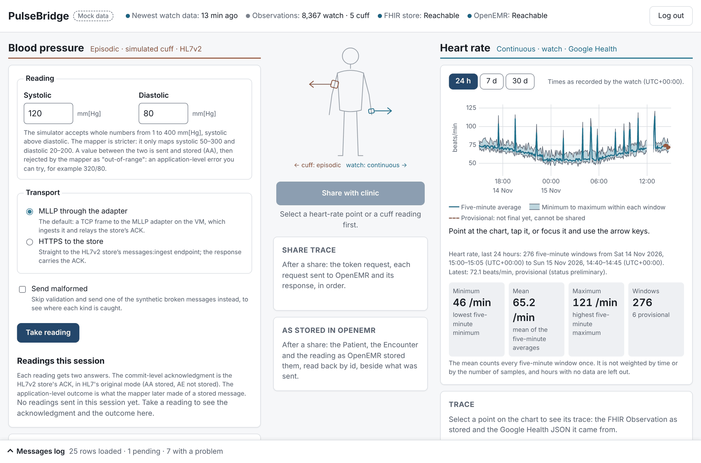
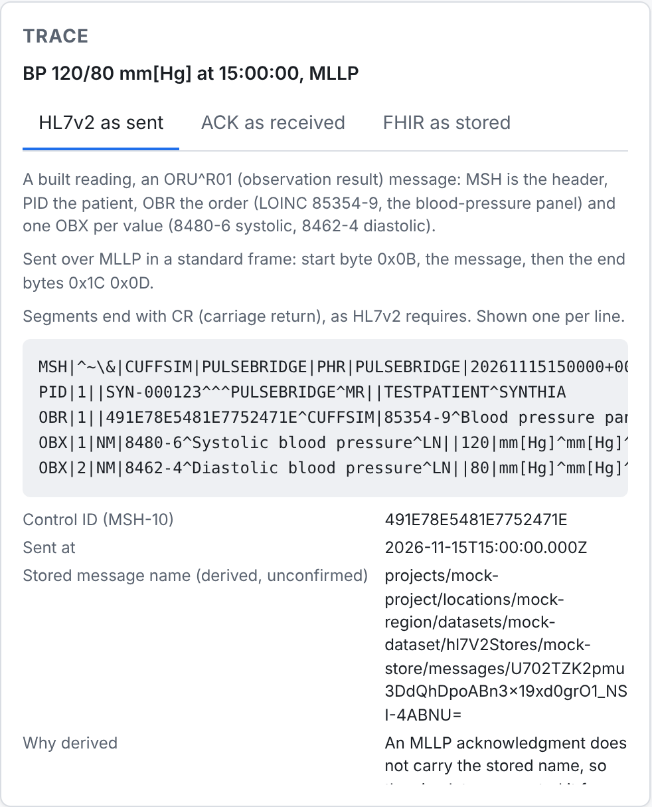
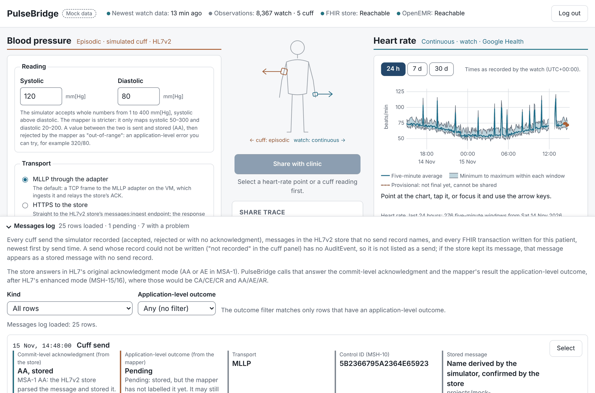
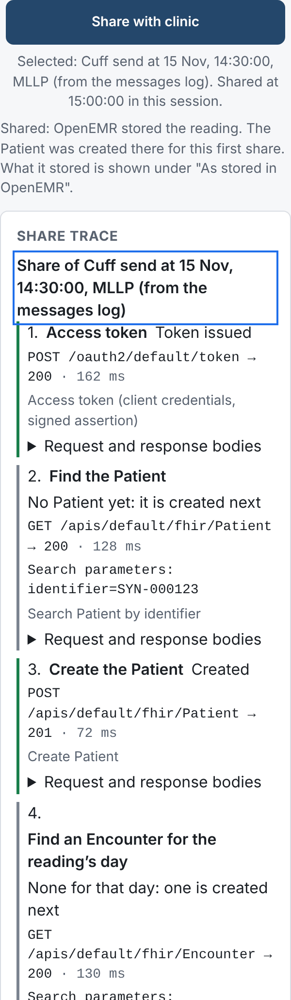

# Setting up PulseBridge in your own Google Cloud project

This guide takes you from a fresh clone of this repository to a running PulseBridge stack in a
Google Cloud project **you** own, and back to nothing when you are done. It assumes you have used
a terminal and git, but not necessarily Google Cloud, Terraform, FHIR or HL7v2: each term is
explained the first time it appears.

> **Honest status.** Every module, service and script was built and tested offline (against
> mocked cloud providers and fake services). The procedure below has since been run **once**, on
> 16 November 2026, on a new **dev** project with **synthetic data**, steps 1 to 3.10: it reached
> a working stack (the VM's first boot, the image build, the applies, the first seeding, the
> page, a reviewer login, cuff readings over MLLP and HTTPS, and shares of a blood pressure and a
> heart rate to OpenEMR), and its corrections are in the steps below. What that run did not
> touch is **not yet verified on a real project**: your own watch data (Step 2 and the connect
> script), prod, the first-deploy measurements of 3.11, alerts firing, patching, password
> rotation, teardown and CI. The runbook's
> [master checklist](../infra/envs/README.md#master-checklist) lists every assumption in the order
> you will meet them and records what the dev run confirmed. If a step below does not behave as
> described, that checklist is where the answer is recorded.

The authoritative, step-by-step procedure is the **runbook** in
[`infra/envs/README.md`](../infra/envs/README.md#the-runbook). This guide explains each step
for a newcomer, says why it exists, and links to the runbook step for the exact commands and
checks. Where the two ever disagree, the runbook wins.

## Contents

- [What you are building](#what-you-are-building)
- [Words you will meet](#words-you-will-meet)
- [Before you start](#before-you-start)
- [What it costs, and how to stop paying](#what-it-costs-and-how-to-stop-paying)
- [Choose your data: synthetic or your own watch](#choose-your-data-synthetic-or-your-own-watch)
- [Step 1: create or adopt a project (bootstrap)](#step-1-create-or-adopt-a-project-bootstrap)
- [Step 2: register a Google Health OAuth app (real data only)](#step-2-register-a-google-health-oauth-app-real-data-only)
- [Step 3: deploy, in the runbook's order](#step-3-deploy-in-the-runbooks-order)
- [Step 4: log in as a reviewer](#step-4-log-in-as-a-reviewer)
- [Step 5: use the dashboard](#step-5-use-the-dashboard)
- [Operating it](#operating-it)
- [Tearing it down](#tearing-it-down)
- [Troubleshooting](#troubleshooting)

## What you are building

PulseBridge is a personal health record (PHR) for one person. It collects two kinds of vital
signs, stores them in a standard format, charts them, and can send selected readings to a
clinic's electronic medical record:

- **Heart rate** from a Pixel Watch, read from the Google Health API every 15 minutes by the
  `health-sync` service (or, in a synthetic deployment, generated by the seeder).
- **Blood pressure** from a *simulated* cuff, sent as an HL7v2 message over MLLP to an adapter
  on a small VM, stored in an HL7v2 store, and turned into FHIR by the `v2-to-fhir` service.
- A **dashboard** (a single web page) behind a shared reviewer password, served by Firebase
  Hosting, with one backend: the `fhir-proxy` service.
- A **clinic**: OpenEMR, an open-source medical record system, running on the same VM. The
  dashboard's **Share with clinic** button writes a reading into it through its FHIR API.

The [README's architecture diagram](../README.md#architecture) shows how the pieces connect.

## Words you will meet

**Health data standards**

- **FHIR** (Fast Healthcare Interoperability Resources, release **R4**): the modern standard for
  exchanging health records as JSON over a REST API. Data is split into **resources**, each a
  typed JSON document with an `id`: a `Patient`, a `Device`, an `Observation`, a `Provenance`.
- **Observation**: the FHIR resource for one measurement (a heart rate, a blood pressure). It
  says *what* was measured (a code), the *value* with its unit, *when*, *about whom* (a reference
  to the Patient) and *with what* (a reference to the Device).
- **LOINC**: the code system that names *what* was measured, so every system reads it the same
  way. PulseBridge uses `8867-4` (heart rate), `85354-9` (blood-pressure panel), `8480-6`
  (systolic) and `8462-4` (diastolic).
- **UCUM** (Unified Code for Units of Measure): the code system for units: `/min` (per minute)
  and `mm[Hg]` (millimetres of mercury).
- **Provenance**: a FHIR resource that records where another resource came from (the watch's
  roll-up window, or the stored HL7v2 message), so a reader can trace every value to its source.
- **Transaction Bundle**: a FHIR `Bundle` of `type: transaction`, a list of writes the server
  applies all together or not at all. Both ingest services write each batch this way.
- **FHIR store**: a managed FHIR server in Google's Cloud Healthcare API. It is the system of
  record for everything above.
- **HL7v2**: the older, pipe-delimited messaging standard that most hospital devices and systems
  still speak. A message is made of **segments** (lines) such as `MSH` (header), `PID`
  (patient), `OBR` (observation request: the panel being reported) and `OBX` (one observation value).
- **ORU^R01**: the HL7v2 message type "unsolicited observation result": a device reporting a
  measurement. The cuff sends one ORU^R01 with two OBX segments per reading.
- **MLLP** (Minimal Lower Layer Protocol): how HL7v2 travels over a plain TCP connection. Each
  message is wrapped in a start byte and two end bytes so the receiver knows where it ends.
- **ACK**: the HL7v2 acknowledgment the receiver sends back. `AA` means accepted (stored); `AE`
  means error (not stored, with a reason). No ACK at all means the message may or may not have
  arrived.
- **HL7v2 store**: Google's managed store for HL7v2 messages. It replies with the ACK, keeps
  each accepted message, and announces it on Pub/Sub (Google's message queue).

**Google Cloud**

- **Project**: the container for everything you create in Google Cloud, with its own billing,
  permissions and APIs. Its **project ID** is a globally unique name you choose.
- **Billing account**: the payment method a project is charged to. Free-tier allowances are
  counted per billing account, not per project.
- **Service account**: an identity for a program rather than a person. Each PulseBridge service
  runs as its own service account with only the permissions it needs ("least privilege").
- **Secret Manager**: Google's store for secret values (passwords, keys, tokens). A **secret** is
  a named container; each value you put in it is a numbered **version**.
- **Application Default Credentials (ADC)**: the login that Google's tools and libraries pick up
  automatically. `gcloud auth application-default login` sets it to your own Google account.
- **Cloud Run**: Google's service for running containers that start on demand and scale to zero
  when idle. Every PulseBridge service and the seeder job run on it.
- **Artifact Registry**: Google's store for container images; the deploy pushes the service
  images there and Cloud Run pulls them from it.
- **OIDC identity token**: a short-lived token, signed by Google, that says which service account
  is calling. Cloud Scheduler, Pub/Sub and `fhir-proxy` attach one when they call a private Cloud
  Run service, and Cloud Run checks it.
- **IAP (Identity-Aware Proxy) TCP forwarding**: a way to reach a VM that has no public address,
  through Google, after Google has checked your identity and roles. Used here only for SSH during
  the first-boot checks.
- **Container-Optimized OS (COS)**: Google's minimal Linux image for VMs that only run
  containers. The edge VM runs it.
- **Workload Identity Federation (WIF)**: lets GitHub Actions act as a Google service account by
  exchanging GitHub's short-lived signed token for a short-lived Google token. No long-lived key
  is ever created or stored in GitHub.

**Terraform**

- **Terraform**: a tool that creates cloud resources from code (`*.tf` files) and then keeps
  them matching that code.
- **Module**: a reusable directory of Terraform code. PulseBridge has seven, under
  [`infra/modules/`](../infra/modules/).
- **Root module (root)**: the directory you run Terraform in. PulseBridge's roots are
  `infra/bootstrap`, `infra/envs/dev` and `infra/envs/prod`.
- **State**: Terraform's record of what it created. Later runs compare it with the code to work
  out what to change. It can contain identifiers and personal data, so treat it as sensitive.
- **Backend**: where the state is kept. PulseBridge keeps it in a Cloud Storage bucket
  (**remote state**), so CI and people share one copy and two runs cannot overlap (the bucket
  backend **locks** it).
- **Plan**: `terraform plan` shows what would change without changing anything. Always read it.
- **Apply**: `terraform apply` makes the changes (it shows the plan first and asks for `yes`).
- **tfvars**: `terraform.tfvars`, your input values for a root. It names your project and, in a
  real deployment, you, so it is git-ignored; each root commits a `terraform.tfvars.example`.

The runbook has a longer list ([Terms used here](../infra/envs/README.md#terms-used-here)).

## Before you start

### Tools

| Tool | Version | Used for |
| --- | --- | --- |
| git | any recent | cloning; the image build reads the commit |
| Google Cloud CLI (`gcloud`) | a current release | logging in, secrets, the image build, looking at the VM |
| Terraform | 1.11 or newer (the roots require `>= 1.11`; providers `google` and `google-beta` `~> 8.11`, pinned by the committed lock files) | every `infra/` step |
| Python | 3.13 or newer | the connect script (real data), `make test` |
| Node.js and npm | Node 22.12 or newer | building and deploying the dashboard (`web/`) |
| A web browser | | the dashboard; the Google consent screen (real data) |
| GitHub CLI (`gh`) | optional | reading your repository's numeric ID for bootstrap; without it, read the `id` field of `https://api.github.com/repos/<owner>/<name>` in a browser |

Optional, for development only: Docker (`make images` builds the service images locally), Java 17
or newer (`make fhir-validate` runs the HL7 FHIR Validator), Go (`make secret-scan` builds
gitleaks), and Chromium for the dashboard's browser tests (`make web-check`).

### Accounts and permissions

- A **Google account** and a **billing account** you can link to a project
  (`roles/billing.user` on it; `gcloud billing accounts list` shows yours). An organization is
  not needed: a personal Google account can create a project with no parent.
- Or an **existing project** where you are **Owner** and billing is already linked.
- **Your own GitHub repository** holding your copy of this code: a fork, or a new repository you
  push your clone to. Bootstrap **requires** its `owner/name` and its numeric ID
  (`github_repository` and `github_repository_id` have no default). Never give it the repository
  you cloned from: Workload Identity Federation trusts exactly the repository you name, and
  whoever controls that repository can run workflows that deploy into your project. Create it
  before Step 1, even if you do not plan to use CI yet.
- **Real data only:** a Pixel Watch (or another device that syncs heart rate to Google Health)
  and the Google account it syncs to.

### Log in with your own credentials

```bash
gcloud auth login                              # gcloud commands, as you
gcloud auth application-default login          # Terraform and the scripts, as you (ADC)
```

Never use a service account key file for this. (An automated session that only has a service
account key from **another** project needs extra settings, because Google then bills quota to
that other project: bootstrap's
[Running it from a service account in another project](../infra/bootstrap/README.md#running-it-from-a-service-account-in-another-project)
and the runbook's
[Running the env roots from a service account in another project](../infra/envs/README.md#running-the-env-roots-from-a-service-account-in-another-project).
A person logged in as themselves does not need any of it.)

Your ADC also needs a **quota project**: an existing project, with the Cloud Billing and Service
Usage APIs enabled, that Google bills the first API calls against while the new project does not
exist yet ([Prerequisites](../infra/bootstrap/README.md#prerequisites)):

```bash
gcloud auth application-default set-quota-project <an-existing-project-id>
```

A new Google account has no project to name here. Two ways out, neither yet tried with this
repository (*not verified*):

- create a first project by hand in the [Google Cloud console](https://console.cloud.google.com/),
  link your billing account to it, enable the Cloud Billing API and the Service Usage API there,
  and use it as the quota project; then let bootstrap create the PulseBridge project
  (`create_project = true`); or
- create the PulseBridge project itself by hand in the same way, set it as its own quota project,
  and let bootstrap **adopt** it (`create_project = false`).

## What it costs, and how to stop paying

**Near $0 a month when idle**, for one deployment on a billing account that has no other e2-micro
VM, plus cents of storage. Everything except one VM scales to zero or is billed per use. The
runbook's [Cost](../infra/envs/README.md#cost) table has the details and caveats; prices marked
"not confirmed" there are not confirmed here either.

| What | Idle cost | Why |
| --- | --- | --- |
| The **e2-micro VM** (OpenEMR, its database, the MLLP adapter), with 20 + 10 GB standard disks | **$0 inside the free tier**: one e2-micro per *billing account*, in `us-central1`, `us-east1` or `us-west1`, and 30 GB-months of standard disk | It is the **only always-on resource**. A second e2-micro on the same billing account (dev and prod, or any other VM of that type) is billed: about $6 a month, not confirmed |
| Artifact Registry (container images) | cents a month | 0.5 GB free; the cached OpenEMR image likely passes it |
| Cloud Healthcare API (FHIR and HL7v2 stores) | cents | billed per request and per GB stored; a few MB |
| Cloud Run (4 services with real data; 3 services and the seeder job with synthetic data), Pub/Sub, Secret Manager, Scheduler | about $0 | scale to zero; Scheduler gives 3 jobs free per billing account |
| Alert policies | $0 until 1 September 2027, then about $0.70 to $1.05 a month | Google's announced pricing for metric references |
| Firebase Hosting | $0 under 10 GB stored and 10 GB a month transferred | |
| Data-disk snapshots (prod only) | cents a month | kept 7 days; they **outlive a destroy** |
| Cloud NAT | **off**; about $4.70 a month plus traffic, **billed hourly**, if you turn it on | only a fallback if the VM cannot pull its images |

**The free-tier caveat.** The free e2-micro is per billing account and only in the three regions
above. Choose another region (`region`/`zone` in tfvars; a Terraform `check` warns you), run two
deployments on one billing account, or change the machine type, and the VM is billed.

**How to stop paying:**

1. `terraform destroy` the environment, then deal with what it leaves behind
   ([Tearing it down](#tearing-it-down)). For dev, do this whenever you are not using it.
2. If you created the project only for PulseBridge, deleting the whole project is the surest way
   to stop every charge: `gcloud projects delete <project-id>` (Google keeps a deleted project
   recoverable for 30 days, then removes it).
3. Watch the billing report for the project a day later: it should show no new charges (this is
   checklist item [T4](../infra/envs/README.md#teardown-dev), not yet verified).

## Choose your data: synthetic or your own watch

One Terraform variable, `use_synthetic_data`, chooses where heart-rate data comes from. Decide
before your first apply: switching later means a fresh FHIR store and a different patient ID.

| | Synthetic (`use_synthetic_data = true`) | Your own watch (`use_synthetic_data = false`) |
| --- | --- | --- |
| Default in | `dev` (the quick start) | `prod` |
| Heart rate from | the **seeder** (`services/seed`), which writes invented five-minute windows, hourly | `health-sync`, which reads your Google Health data every 15 minutes |
| Needs a Pixel Watch or an OAuth app | no | yes ([Step 2](#step-2-register-a-google-health-oauth-app-real-data-only)) |
| `patient_id` | **must** start with `SYN-`, for example `SYN-0001` | must **not** start with `SYN-`, for example `PAT-0001` |
| Patient name | always `Synthetic` / `Demo` (setting one is refused) | yours (`patient_family_name`, `patient_given_name`), and your gender and birth date in a private file for the connect script |
| Setup step that writes the Patient | the first seeding | the connect script |
| Health data | invented; safe to show anyone | **real personal health information**: treat the project, its state and its logs as private |

The blood-pressure cuff is simulated in both modes, so the HL7v2 path works end to end with no
external account at all.

**Never run the Google Health connect script against a synthetic patient ID** (one starting
with `SYN-`). The script refuses such an ID, the env roots refuse a `SYN-` ID without synthetic
data, and a synthetic deployment's `setup_env` output warns on its second line, but the rule is
worth knowing: a `SYN-` deployment must never hold a real person's data, and the seeder refuses
to touch a store whose Patient is not its own.

**Use synthetic data for anything you show or screenshot.** Every image in this repository was
taken with synthetic data.

## Step 1: create or adopt a project (bootstrap)

**What it does.** [`infra/bootstrap`](../infra/bootstrap/README.md) is a small Terraform root
that **you** run **once per project**, with your own Google login. It:

- creates the project and links your billing account (`create_project = true`), or adopts a
  project that already exists (`create_project = false`, nothing changed at project level);
- enables the six APIs bootstrap itself needs (the rest are enabled later by module
  `project-base`);
- creates a private, versioned **Cloud Storage bucket for Terraform state**;
- creates the **`terraform-deployer` service account** with one predefined admin role per Google
  product the stack uses (never Owner or Editor);
- creates a **Workload Identity Federation** pool and GitHub provider restricted to **one**
  repository (by name and numeric ID), so CI can act as the deployer without a key;
- adds **Firebase** to the project (`add_firebase = true`, the default), which the dashboard's
  Hosting site needs. This cannot be undone, and costs nothing.

**Why it exists.** Everything else needs a place to keep its state, an identity to deploy as and
a way for CI to authenticate. Those cannot be created by the environment roots themselves (they
would be storing their state in a bucket they have not created yet), so a person creates them
once. Bootstrap itself starts with **local** state, because its bucket does not exist yet; its
README shows how to move that state into the bucket afterwards
([State: the chicken-and-egg](../infra/bootstrap/README.md#state-the-chicken-and-egg)).

**Use separate projects for dev and prod**, and run bootstrap once for each. The same resource
names are used in both, and one project per environment keeps a mistake in dev away from prod.

```bash
cd infra/bootstrap
cp terraform.tfvars.example terraform.tfvars   # git-ignored; fill in your values
terraform init
terraform plan                                 # read it: this is a real project
terraform apply
terraform output                               # values for the env roots and GitHub
```

In `terraform.tfvars`, pick one mode and set `project_id`, `billing_account` (create mode only),
`github_repository` (`<owner>/<name>` of **your own** repository, see
[Accounts and permissions](#accounts-and-permissions)) and `github_repository_id`
(`gh api repos/<owner>/<name> --jq .id`, or the `id` field of the GitHub API address above). Leave `deployer_roles` at its default unless you have
read [Deployer roles](../infra/bootstrap/README.md#deployer-roles).

**How to know it worked.** `terraform output` shows `project_id`, `state_bucket_name`,
`deployer_service_account_email`, `workload_identity_provider` and `firebase_added = true`. On a
brand-new project the first apply may stop with "API has not been used in project ... or it is
disabled": wait a minute and run `terraform apply` again; it continues where it stopped.
Runbook: [step 1](../infra/envs/README.md#1-bootstrap-the-project-once-per-project-owner).
On the 16 November dev deploy bootstrap adopted an existing project and ended with
`firebase_added = true`, run from a service account key rather than a person's login; creating a
project, and Workload Identity Federation, are *not yet verified on a real project* (checklist
A13, A14).

### Roles you need, and the roles the deployer gets

| Who | Needs | For |
| --- | --- | --- |
| You, running bootstrap | Owner on the project (adopt), or `roles/billing.user` on the billing account (create) | creating the project, the bucket, the deployer, WIF and Firebase |
| The `terraform-deployer` service account | the list in [Deployer roles](../infra/bootstrap/README.md#deployer-roles) (Service Usage, Compute network/security/instance admin, Artifact Registry, IAM service accounts and project IAM, Secret Manager, Healthcare dataset/FHIR/HL7v2 admin, Pub/Sub, Cloud Run, Scheduler, logging and monitoring writers, Firebase Hosting) and object admin on the state bucket | every environment apply, and CI |
| You, running the env roots by hand | either the same roles yourself, or `roles/iam.serviceAccountTokenCreator` on the deployer and `deployer_service_account_email` set in tfvars (Terraform then **impersonates** the deployer) | steps 2 to 13 |
| You, running the image build | with the trigger: nobody (Cloud Build runs as the opt-in build account; you approve the build as the Owner). By hand: the project Owner | step 7 |
| You, running the connect script (real data) | `roles/secretmanager.secretAccessor` on the client ID and client secret secrets, `roles/secretmanager.secretVersionAdder` on all three Google Health secrets, `roles/healthcare.fhirResourceEditor` on the main FHIR store (or a project role that includes them, such as Owner) | step 9 |
| You, looking at the VM | `roles/iap.tunnelResourceAccessor`, `roles/compute.osAdminLogin`, and `roles/iam.serviceAccountUser` on the VM's service account | the first-boot checks |

Be aware: the deployer holds `roles/resourcemanager.projectIamAdmin`, so anyone who can become it
can grant themselves anything. The real boundary is who can become the deployer: you, and, in the
one GitHub repository WIF trusts, only jobs on `main` (dev) or in the protected `prod` Environment
(prod). Bootstrap's README spells this out
([What the role list does and does not limit](../infra/bootstrap/README.md#deployer-roles)).

### CI with GitHub Actions

`.github/workflows/terraform-*.yml` run checks and a dev plan on every pull request, apply dev on
every merge to main, and apply prod after an approval in a protected GitHub Environment. They
authenticate with Workload Identity Federation only: no key is stored in GitHub. A read-only
**planner** makes the plans, the **deployer** applies, and a **page deployer** that can only touch
Firebase Hosting deploys the page. The values they need are identifiers, not secrets, so they go
in GitHub **repository variables**, five per environment: `DEV_GCP_WORKLOAD_IDENTITY_PROVIDER`,
`DEV_TF_STATE_BUCKET`, `DEV_GCP_DEPLOYER_SA`, `DEV_GCP_PLANNER_SA`, `DEV_GCP_PAGE_DEPLOYER_SA`,
and the same with `PROD_`; optionally `DEV_NIGHTLY_DESTROY` and `PROD_WITHOUT_DEV`. Every job
skips until its variables are set, and CI takes over an environment only after you have done its
first full apply by hand (steps 3.1 to 3.7 below). The order of the setup matters (the GitHub
Environments before prod's bootstrap): follow
[CI/CD](../infra/envs/README.md#cicd-t26) in the runbook.

## Step 2: register a Google Health OAuth app (real data only)

Skip this step with synthetic data.

**What it is.** To read your heart rate, `health-sync` needs your permission, given through
**OAuth 2.0**: you approve access once in a Google consent screen, and Google returns a
**refresh token**, a long-lived credential the service uses to get short-lived access tokens
without you. Google only issues tokens to a registered **OAuth app** (a consent screen plus an
**OAuth client**: a client ID, which is public, and a client secret, which is not). Each deployer
registers their **own** app in their **own** project (decision D2): the repository never
contains anyone's client, secret or token.

**Why by hand.** The OAuth consent screen and client cannot be created by Terraform; this is the
one component registered in the console.

In the [Google Cloud console](https://console.cloud.google.com/), in your project:

1. **Enable the Google Health API** (APIs & Services > Library). Module `project-base` also
   enables it on apply (`health.googleapis.com`; that this is the right service name is
   checklist item A4).
2. **Configure the consent screen** (Google Auth Platform): user type **External**. The app starts
   in **Testing** status.
3. **Add yourself as a test user** (Google Auth Platform > Audience > Test users): the Google
   account your watch syncs to. In Testing status **only listed test users** can grant access.
4. **Add the scope** on the Data Access page:
   `https://www.googleapis.com/auth/googlehealth.health_metrics_and_measurements.readonly`
   ("see health metrics and measurements"). Spike S3 found this one read-only scope covers heart
   rate.
5. **Create an OAuth client of type "Desktop app"** (Google Auth Platform > Clients). A Desktop
   client accepts the connect script's redirect to `http://127.0.0.1:<any port>`; a "Web
   application" client would need that exact address registered. Keep the client ID and secret
   to paste when the script asks; do not save them in a file.

**How to know it worked.** In Google Auth Platform: Audience shows publishing status "Testing"
and your account under Test users; Data Access lists the scope above; Clients lists your client
with type "Desktop". The real proof comes in [3.8](#38-the-setup-step-write-the-patient-exactly-one-of-the-two),
when the connect script stores a refresh token. *Not yet verified with this repository's script*
(checklist I14, I15).

### Testing status: the 7-day refresh token

While the app's publishing status is **Testing**:

- only the test users you listed can connect, and
- **every refresh token expires after 7 days** (Google: an External app in Testing "is issued a
  refresh token expiring in 7 days"; spike S3 saw `refresh_token_expires_in` of 604799 seconds).

When it expires, `health-sync` stops syncing (it does not crash): the dashboard's status strip
shows **"reconnect needed"**, and the `health-sync-not-connected` alert emails you. The fix is to
run the connect script again ([Reconnecting Google Health](#reconnecting-google-health-real-data)).

**Moving to "In production"** stops the weekly reconnect: Google Cloud console > Google Auth
Platform > Audience > **Publish app**. A production app's refresh token has no fixed expiry; it
stops working if you revoke access, if it is unused for six months, or for Google's other listed
reasons. **Not tested:** whether Google then requires app verification for the health scope
(checklist I20). If it does, staying in Testing and reconnecting weekly is the fallback.

The connect script's README has the full detail
([Expiry, honestly](../scripts/connect-google-health/README.md#expiry-honestly)).

## Step 3: deploy, in the runbook's order

Run every Terraform command from `infra/envs/dev` (or `prod`). Each step below says what it does,
why it comes where it does, the command, and how to tell it worked. The runbook step linked from
each has the full checks. `terraform output -raw next_steps` prints the remaining steps with your
deployment's names filled in.

**Why the order matters.** Three things force it: the images must be pushed to a registry that
Terraform creates; the VM must register its OpenEMR client (which writes a secret version) before
`fhir-proxy`, which mounts that secret, is created; and the Patient must be written once, by a
setup step, before anything ingests data on its own (decision D11, otherwise two services could
each create a Patient at first contact).

### 3.1 Configure the backend and your values

```bash
cd infra/envs/dev                                  # or prod
cp backend.hcl.example backend.hcl                 # git-ignored; set bucket = <state_bucket_name>
cp terraform.tfvars.example terraform.tfvars       # git-ignored; fill in (images come in 3.6)
terraform init -backend-config=backend.hcl
```

**What and why.** `backend.tf` names the state prefix (`dev` or `prod`) but not the bucket,
which would name your project; you give the bucket at `init` from the git-ignored
`backend.hcl`. In `terraform.tfvars` set at least `project_id`, `patient_id`,
`patient_assigning_authority`, `time_zone` (your IANA zone, for example `America/New_York`), an
`alert_email` (or `alert_notification_channels`), the patient name with real data, and
`ingest_enabled = false`. The runbook's [What a stranger sets](../infra/envs/README.md#what-a-stranger-sets)
table explains each.

**Running as the deployer.** If you set `deployer_service_account_email` instead of holding the
deployer's roles yourself, the project owner first lets you impersonate it, once:

```bash
gcloud iam service-accounts add-iam-policy-binding <deployer_service_account_email> \
  --member="user:<your-google-account>" --role=roles/iam.serviceAccountTokenCreator \
  --project <project-id>
```

This is an IAM change on a real project: it lets your account act as the deployer.

**About the alert address:** `alert_email` is a sensitive variable, so plans, including the ones
CI posts on pull requests, show `(sensitive value)` instead of the address. It is still stored in
the state ([What a plan shows](../infra/envs/README.md#what-a-plan-shows)).

**Worked when:** init says `Successfully configured the backend "gcs"` and `git status` shows no
change to `.terraform.lock.hcl`. Runbook:
[step 2](../infra/envs/README.md#2-configure-the-backend-and-initialise-deployer-or-owner).
Done once on the 16 November dev deploy.

### 3.2 First targeted apply: APIs, network, registry

```bash
terraform apply -target=module.stack.module.project_base
```

**What and why.** `-target` applies only the named module (and what it depends on). This one
enables the stack's APIs and creates the VPC network, its subnets, the firewall rule and the two
Artifact Registry repositories (`pulsebridge-services` for our images, `pulsebridge-dockerhub`,
a cache of Docker Hub). It also creates module `identity`'s **service accounts** (not its
secrets): project-base's firewall rule and mirror grant name the edge VM's account, and Terraform
pulls in what a targeted module depends on. The registry must exist before the images can be
pushed to it (3.6). Terraform warns that targeting is in effect; that is expected here.

**Worked when:** `gcloud artifacts repositories list --project <project-id>` shows both
repositories. Runbook: [step 3](../infra/envs/README.md#3-first-targeted-apply-apis-network-registry-deployer).
Confirmed on the 16 November dev deploy (A1).

### 3.3 Second targeted apply: identities and empty secrets

```bash
terraform apply -target=module.stack.module.identity
```

**What and why.** The service accounts already exist (3.2); this creates module `identity`'s
**eight empty secrets** and who may read each. It is a separate step because the secrets need the
Secret Manager API that 3.2 enabled. In dev, if you chose to give the reviewer password through
Terraform, it is written here ([Step 4](#step-4-log-in-as-a-reviewer)); the simpler route is the
script in 3.4.

The secrets are named `<prefix>-<key>`, where `<prefix>` is `identity_name_prefix` (default
`pb`; `terraform output -raw secret_name_prefix` prints it). The scripts and services know **only
these names**: if you create a secret by hand under another name, nothing will read it.

| Secret | Read by | Its value is written by |
| --- | --- | --- |
| `pb-google-health-client-id` | `health-sync` | the connect script (real data) |
| `pb-google-health-client-secret` | `health-sync` | the connect script (real data) |
| `pb-google-health-refresh-token` | `health-sync` | the connect script (real data) |
| `pb-openemr-client-private-key` | `fhir-proxy` | the VM itself, on first boot. **Never write it yourself** |
| `pb-reviewer-password` | `fhir-proxy` | you (3.4), or in dev Terraform from tfvars, never both |
| `pb-db-root-password` | the VM | you (3.4) |
| `pb-openemr-db-password` | the VM | you (3.4) |
| `pb-openemr-admin-password` | the VM | you (3.4) |

This step also creates the project's **Pub/Sub service agent** (the Google-managed account Pub/Sub
uses inside your project) before granting it the right to sign the push subscription's tokens.
On a new project that agent may not exist yet; on the 16 November dev deploy the grant failed
until it was created, which is why the module now creates it.

**Worked when:** `gcloud secrets list --project <project-id>` shows the eight secrets and the
apply ends without error. Runbook:
[step 4](../infra/envs/README.md#4-second-targeted-apply-identities-and-empty-secrets-deployer).
Confirmed on the 16 November dev deploy (A2), apart from the agent, which was then created by
hand; the module creating it is new since (A22).

### 3.4 Secret values

**What and why.** Terraform created the secrets empty, so that no password is ever in code, in a
plan or in Terraform state. You now add one **version** to each of `db-root-password`,
`openemr-db-password`, `openemr-admin-password` and (prod, or dev without a tfvars password)
`reviewer-password`. Values must be stored **without a trailing newline** (the VM reads them
into password files), and the reviewer password needs **at least 16 characters** (24 or more is
better).

With the scripts in `scripts/secrets/` (their README has the details), values come from a hidden prompt (typed
twice), from standard input when it is not a terminal, or are generated; they are never echoed,
never passed as an argument and never written to disk. Values must be 16 to 128 printable ASCII
characters. The project comes from `CLOUDSDK_CORE_PROJECT` (or `--project`) and the prefix from
`SECRET_NAME_PREFIX` (or `--prefix`). Run them from the repository root:

```bash
export CLOUDSDK_CORE_PROJECT=<project-id>
export SECRET_NAME_PREFIX="$(terraform -chdir=infra/envs/dev output -raw secret_name_prefix)"
scripts/secrets/set-secret.sh --generate db-root-password       # 32 random characters, never shown
scripts/secrets/set-secret.sh --generate openemr-db-password
scripts/secrets/set-secret.sh openemr-admin-password            # or --generate; hidden prompt
scripts/secrets/set-reviewer-password.sh --generate             # prints the new password once
```

- `set-secret.sh` accepts exactly `db-root-password`, `openemr-db-password` and
  `openemr-admin-password`, and refuses any other name.
- It refuses to add a version when the secret already has an enabled one, unless you pass
  `--replace` (rotation: see the scripts' README).
- `set-reviewer-password.sh --generate` prints the password once, after it is stored, and only to
  a terminal (add `--show` to send it to a pipe on purpose). Without `--generate` it prompts.
- `openemr-admin-password` is OpenEMR's `admin` login, which you only need to look at OpenEMR's
  own screens through IAP; if you generate it, nobody can read it except through Secret Manager.

The runbook's [step 5](../infra/envs/README.md#5-secret-versions-deployer-scriptssecrets) has the
exact commands. Never type a secret on a command line, where it would stay in your shell history.

**Worked when:** `gcloud secrets versions list <prefix>-db-root-password --project <project-id>`
shows version 1 `enabled`, and the same for each secret you set. On the 16 November dev deploy
the three VM passwords were generated this way before the VM's first boot, and the dev reviewer
password was set with the script before the full apply.

### 3.5 The edge VM and its first boot

```bash
terraform apply -target=module.stack.module.edge_vm
```

**What and why.** This creates the e2-micro VM, its data disk and its internal address. On first
boot (about **20 minutes** on the 16 November dev deploy, 12.5 of them pulling OpenEMR's 3.6 GB
image) it mounts the disk, starts the
**MLLP adapter** (Google's open-source program that receives MLLP and forwards each message to the
HL7v2 store), MariaDB and OpenEMR, then **registers `fhir-proxy` as an OAuth client of OpenEMR**
and stores that client's private key in `pb-openemr-client-private-key`. That is why the VM comes
before the full apply: `fhir-proxy` mounts that secret. The VM has **no public IP** and no open
port to the internet; only Cloud Run's subnet can reach MLLP (2575) and OpenEMR (443).

To watch the boot:

```bash
gcloud compute instances get-serial-port-output pulsebridge-edge-vm \
  --zone us-central1-a --project <project-id>   # <name_prefix>-edge-vm, in your zone
```

For a shell on the VM (to work through the first-boot checks), set `enable_iap_ssh = true`, run
this step's apply again, and use `gcloud compute ssh ... --tunnel-through-iap` as the runbook
shows; set it back to `false` afterwards.

**Worked when:** the log shows `edge VM startup: done, all steps ok`, with `hook openemr: ok` and
`hook openemr-oauth-client: ok`, and `gcloud secrets versions list
<prefix>-openemr-client-private-key --project <project-id>` shows one version. Runbook:
[step 6](../infra/envs/README.md#6-targeted-apply-of-the-edge-vm-and-its-first-boot-deployer-with-a-shell-on-the-vm)
and checklist items E1 to E19, then O1 to O21. On the 16 November dev deploy every step ended
`ok`, with no Cloud NAT (the serial port output above was enough to follow it); the reboot,
patching and crash checks are still open. If the image pulls fail, the fallback is
`enable_cloud_nat = true`, which is **billed hourly**.

### 3.6 Build the container images

```bash
gcloud builds submit --config cloudbuild.yaml --project <project-id> \
  --substitutions TAG_NAME=v0.1.0,COMMIT_SHA="$(git rev-parse HEAD)" .   # from the repository root
gcloud builds log <BUILD_ID> --project <project-id> | sed -n '/BEGIN tfvars/,/END tfvars/{//!p}'
```

**What and why.** Cloud Build builds one image per `services/*/Dockerfile` and pushes it to the
registry from 3.2. The build ends by printing a `BEGIN tfvars` block: five lines such as
`cuff_sim_image = "...@sha256:<64 hex>"`. Paste them unchanged into `terraform.tfvars`. Images
are referenced **by digest** (the hash of their exact bytes), so an apply always deploys exactly
what was built; the roots refuse an image given by tag. `<BUILD_ID>` is printed by `gcloud
builds submit` as it starts (the `ID` column, and in the build's console link); `gcloud builds
list --project <project-id> --limit=1` shows it too. `gcloud builds log` prints the block without
any step prefix (seen on the 16 November dev deploy), so it pastes as it is. A build started by
hand runs as Cloud Build's default account, which in a new project is the **Compute Engine
default service account**, unless you pass `--service-account` (runbook step 7).

`gcloud builds submit` also creates a bucket `gs://<project-id>_cloudbuild` that `terraform
destroy` does not remove. Instead of building by hand you can let a Cloud Build **trigger** build
on every release tag, as an opt-in build account that can only push images (the runbook's step
7, "With the trigger").

**Worked when:** you have five `<name>_image = "...@sha256:..."` lines. Runbook:
[step 7](../infra/envs/README.md#7-build-the-images-the-build-trigger-or-the-owner-by-hand) and
[`services/README.md`](../services/README.md#build-in-cloud-build). Confirmed by hand on the 16
November dev deploy (C1 to C5); the trigger and tagging an existing image are not (C6, C7, CI13).

### 3.7 First full apply, ingest off

```bash
terraform apply            # with ingest_enabled = false
terraform output -raw next_steps
```

**What and why.** The Healthcare dataset, the HL7v2 store and its Pub/Sub topic already exist:
3.5 pulled them in, because the MLLP adapter's settings name the store. This apply creates
everything else: the FHIR store, the separate audit FHIR store (cuff send records), the Pub/Sub
subscription and dead-letter topic, the Cloud Run services (`v2-to-fhir`, `health-sync` or the seeder job,
`fhir-proxy`, `cuff-sim`); the Firebase Hosting site; the alerts. With `ingest_enabled = false`
**no Scheduler job exists and the HL7v2 subscription does not push**, so nothing writes to the
FHIR store by itself before the setup step.

**Worked when:** the apply ends without error, `terraform output scheduler_job_names` is `[]`
and `terraform output push_enabled` is `false`. Real data: if it stops at
`google_cloud_run_v2_service.health_sync` on a secret error, run the connect script (3.8) now and
apply again. Then run checklist item E8's `AA` test (a test message through the MLLP adapter must
get `AA`; the VM's ingest grant on the store is created by this apply). Runbook: [step 8](../infra/envs/README.md#8-first-full-apply-ingest-off-deployer).
Confirmed on the 16 November dev deploy with synthetic data (A10, A11); A19 only partly (the
apply did not stop at fhir-proxy, with the secret's version present; whether Cloud Run refuses a
secret with no version is still open); the real-data health-sync case is not verified (A8).

### 3.8 The setup step: write the Patient (exactly one of the two)

**Why.** The Patient resource is written once, in full, by a setup step using a FHIR
**conditional update** (`PUT Patient?identifier=...`: "find the Patient with this identifier and
replace it, or create it if there is none"), so running it again is safe. The ingest services
later only *link* to it (a conditional create that never overwrites).

**Synthetic data: the first seeding.** It writes the synthetic Patient and 30 days of invented
heart-rate windows; it should take about 15 minutes (an estimate, not measured on Cloud
Healthcare):

```bash
gcloud run jobs execute "$(terraform output -raw seed_job_name)" \
  --region "$(terraform output -raw region)" --project <project-id> \
  --args=--days,30 --task-timeout=1800s --wait
```

Worked when: the execution succeeds and its `seed-run` log line has outcome `seeded`. Stopped
part-way? Run it again: every write is keyed.

**Real data: connect Google Health.** Run on your own computer, with your own ADC, after
[Step 2](#step-2-register-a-google-health-oauth-app-real-data-only). **Keep your demographics out
of your shell history:** put them in a private file outside the repository, never on a command
line (a flag's value is also visible to other users in `ps` while the script runs):

```bash
terraform output -raw setup_env > ~/pulsebridge-prod.env    # OUTSIDE the repository
chmod 600 ~/pulsebridge-prod.env
"${EDITOR:-nano}" ~/pulsebridge-prod.env                     # add the four lines below
```

```bash
# lines to add to ~/pulsebridge-prod.env (your values; this file is never committed)
export PATIENT_FAMILY_NAME=<family name> PATIENT_GIVEN_NAME=<given name>
export PATIENT_GENDER=<male|female|other|unknown> PATIENT_BIRTH_DATE=<YYYY-MM-DD>
```

```bash
source ~/pulsebridge-prod.env && ../../../scripts/connect-google-health/connect.sh   # from infra/envs/prod
```

`setup_env` holds the project, the Healthcare location, dataset and store IDs, `PATIENT_ID` and
the secret prefix (it is a sensitive output because it carries the patient ID). The script then:

1. asks for the OAuth **client ID** and **client secret** at hidden prompts (first run only) and
   stores them in `pb-google-health-client-id` and `pb-google-health-client-secret`;
2. opens your browser at Google's consent screen (the **authorization code flow with PKCE**:
   Google redirects your browser to the script listening on `127.0.0.1`, with a one-time code the
   script exchanges for tokens; PKCE stops a stolen code being used by anyone else);
3. stores the **refresh token** as a new version of `pb-google-health-refresh-token`, and says
   when it expires;
4. writes your **Patient** to the FHIR store (conditional update).

**When the browser is on another machine** (you are on SSH or a cloud shell), add `--paste`: the
script prints Google's address; open it, approve, and when the browser fails to load
`http://127.0.0.1:<port>/?...` (expected), copy that whole address and paste it at the hidden
prompt ([details](../scripts/connect-google-health/README.md#when-the-browser-is-on-another-machine)).

Worked when: it ends `Done.` after "Patient record created", with exit code 0. Exit code 3 means
connected but the Patient write failed: run it again. Runbook:
[step 9](../infra/envs/README.md#9-the-setup-step-write-the-patient-one-of-the-two-never-both).
*Not yet verified against Google or a real project* (I1, I14 to I20).

### 3.9 Second apply: ingest on

Set `ingest_enabled = true` in `terraform.tfvars`, then:

```bash
terraform apply
```

**What and why.** One switch does both: module `ingestion` creates the Cloud Scheduler job
(`health-sync` every 15 minutes, or the seeder hourly) and module `healthcare` turns the HL7v2
subscription into a **push** subscription to `v2-to-fhir`. Cuff messages that arrived while it
was off wait in the subscription (up to 7 days) and are delivered now.

**Worked when:** `terraform output scheduler_job_names` lists one job and `push_enabled` is
`true`. Runbook: [step 10](../infra/envs/README.md#10-second-apply-ingest-on-deployer).
Confirmed on the 16 November dev deploy.

### 3.10 Deploy the dashboard

Run this from the **repository root** (not `infra/envs/dev`):

```bash
terraform -chdir=infra/envs/dev output -raw firebase_json > web/firebase.json   # git-ignored
(cd web && npm ci && npm run build)          # VITE_FHIR_PROXY_URL unset: the page calls /api
(cd web && npx --yes firebase-tools@15.34.2 deploy --only hosting \
    --project "<project-id>" --non-interactive)
```

**What and why.** Terraform can create the Hosting site but cannot upload files to it, so the
page is built with Vite and uploaded with the Firebase CLI. `firebase.json` comes from
Terraform's output and carries the **rewrite** that sends `/api/**` to `fhir-proxy` on the same
address as the page, plus the security headers. Run this after **every** apply: a Terraform
change to the rewrite or headers reaches the site only with a deploy. Once CI manages the
environment it does this after every apply, with the same `firebase-tools` version locked in
`infra/envs/ci/deploy-tools/package-lock.json`.

**Worked when:** `terraform output -raw dashboard_url` (`https://<site>.web.app`) shows the login
page. Runbook: [step 11](../infra/envs/README.md#11-deploy-the-page-deployer-after-every-apply).
Confirmed on the 16 November dev deploy, with an Owner's credentials; that the deployer's
Hosting role alone is enough is *not yet verified on a real project* (P12).

### 3.11 First-deploy checks

The runbook's [step 12](../infra/envs/README.md#12-the-front-doors-first-deploy-checks-deployer)
(the front door: confirm `trusted_proxy_hops` first, then logins, the rewrite, the security
policy, the time limits) and
[step 13](../infra/envs/README.md#13-the-ingestion-checks-deployer) (first and second sync run,
alerts) are first-deployment checks, listed in the master checklist's tables
[The front door (steps 11 and 12)](../infra/envs/README.md#the-front-door-steps-11-and-12) and
[The setup step and ingestion (steps 9, 10 and 13)](../infra/envs/README.md#the-setup-step-and-ingestion-steps-9-10-and-13). Please record what you find there:
that is how this project's open assumptions get closed. Most of them read log lines, which the
deployer cannot do: run those as the project's owner or with `roles/logging.viewer`. The 16
November dev deploy did not do the hop measurement; a session on 17 November did (P1): behind
Firebase Hosting the proxy sees 2 forwarding hops, and 2 is now the default of
`trusted_proxy_hops`, so you set nothing unless your measurement shows another shape. (The
proxy service's own default is 1, right only when it is called at its `run.app` URL with nothing
in front; Terraform sets 2 for it.) Then run the end-to-end smoke test,
[step 14](../infra/envs/README.md#14-end-to-end-t29) (`make smoke`, see
[`tests/e2e/README.md`](../tests/e2e/README.md)): it checks the cuff path from the front door to
OpenEMR and, on a real-data stack, the first-sync checks of step 13 from health-sync's logs.

## Step 4: log in as a reviewer

The dashboard has **one shared password**, not user accounts (decision D9). `fhir-proxy` checks
it and hands back a signed **session token** valid for **8 hours**, kept in the browser tab's
`sessionStorage` (per tab, gone when the tab closes) and sent with every request (no cookie). After five wrong passwords within a minute from one
address, further attempts from it are refused (HTTP 429, with the seconds to wait) until the
oldest failure is a minute old.

Set the password one of two ways, **never both** in one environment:

- **Recommended, prod and dev:** `scripts/secrets/set-reviewer-password.sh` (3.4
  above), with `reviewer_password_wo_version` left at its default `0`. Until a version exists the
  login page answers "Reviewer login is not configured" (HTTP 503).
- **dev only, through Terraform** (more work, see the note below): set `reviewer_password_wo_version = 1` in `terraform.tfvars`
  and give the password to the apply through the environment, read without echo, and remove it
  afterwards whether or not the apply succeeds:

  ```bash
  IFS= read -rs TF_VAR_reviewer_password; export TF_VAR_reviewer_password
  terraform apply; unset TF_VAR_reviewer_password
  ```

  It is a **write-only** value: sent to Secret Manager, never saved in the plan or the state.

  **The catch:** while `reviewer_password_wo_version` is above 0, **every later** `terraform plan`
  or `apply` in that root needs `TF_VAR_reviewer_password` set again (read it the same way, and
  unset it afterwards); without it the run stops with "reviewer_password must be set when
  reviewer_password_wo_version is greater than 0". That is why the script is the simpler route.

Open `terraform output -raw dashboard_url` and enter the password. **It worked** when the
dashboard replaces the login page and the status strip fills in (confirmed on the 16 November dev
deploy, checklist P2). Give it to reviewers through
a private channel; to take access away, rotate it
([Rotating the reviewer password](#rotating-the-reviewer-password)).

## Step 5: use the dashboard



*The dashboard in **mock mode** (`npm run dev` in `web/`), with synthetic data and no server. A
deployed dashboard looks the same without the "Mock data" badge.*

You can try the page locally with no cloud at all: `cd web && npm ci && npm run dev`, then open
`http://localhost:5173` (any non-empty password logs in to the mock).

- **Status strip** (header): when the watch data was last synced, how many Observations each
  source has, and whether the FHIR store and OpenEMR are reachable. "Reconnect needed" here means
  the Google Health refresh token has expired.
- **Heart rate** (right): five-minute averages with the minimum-to-maximum band, last 24 hours by
  default, or 7 or 30 days. Points not final yet are drawn as "provisional" and cannot be
  shared. Select a point to see its **trace**: the FHIR Observation as stored and the Google
  Health JSON (the roll-up window) it came from.
- **Blood pressure** (left): the **cuff simulator**. Enter systolic and diastolic (whole numbers
  1 to 400 mm[Hg], systolic above diastolic), choose the transport (**MLLP** through the adapter
  on the VM, the default, or **HTTPS** straight to the HL7v2 store) and select **Take reading**.
  Each reading shows two answers: the **commit-level acknowledgment** (the store's ACK: `AA`
  stored, `AE` not stored, or no acknowledgment) and, a few seconds later, the
  **application-level outcome** (what `v2-to-fhir` made of it: accepted, or an error with a
  reason). Tick **Send malformed** to send one of the prepared broken messages and see which
  layer catches it. Its trace shows the HL7v2 message as sent, the ACK as received and the FHIR
  Observation as stored. Sends are rate-limited.

  

- **Messages log** (bottom strip): every cuff send attempt (accepted, rejected, or with no
  acknowledgment), stored messages no attempt names, and every FHIR transaction for the patient,
  newest first, with filters. A row's **Select** picks that reading for sharing.

  

- **Share with clinic** (middle): sends the **one selected, final** reading to OpenEMR. A
  confirmation first lists what leaves and what does not:
  - **sent:** the Patient's identifier on every share (to search for the Patient); the
    official name, gender and birth date only if OpenEMR does not have the Patient yet; an
    Encounter (a visit) for the reading's day in UTC, because OpenEMR files vitals on a visit;
    and the Observation's status, category, code, method text, value and unit, components and
    time;
  - **never sent:** the Google Health user ID, PulseBridge's own resource IDs and metadata, the
    device, the performer, notes or any other reference.

  The **share trace** then lists each request in order: the OAuth token request
  (`fhir-proxy` signs a short assertion with the private key the VM registered: the **client
  credentials grant** with `private_key_jwt`), the Patient search or create, the Encounter search
  or create, the Observation create, and the read-backs. **As stored in OpenEMR** shows what
  OpenEMR actually kept, read back from its FHIR API, beside what was sent. A heart-rate window
  is sent at its start time, and OpenEMR keeps the average only (read from OpenEMR 8.5.0's
  source, and confirmed against a live OpenEMR 8.5.0 on the 16 November dev deploy: it accepted the
  reading and kept the average only, without its components).

  

  *Mock mode: the OpenEMR answers above come from the page's mock client, not a real OpenEMR.*

## Operating it

### Rotating the reviewer password

Rotating ends every session at once, because the session tokens are signed with a key derived
from the password.

- **prod (and dev without a tfvars password):** run `scripts/secrets/set-reviewer-password.sh`
  again. `fhir-proxy` reads the newest version within about 30 seconds.
- **dev with a tfvars password:** raise `reviewer_password_wo_version` by one and apply with the
  new `TF_VAR_reviewer_password` (read and unset as in [Step 4](#step-4-log-in-as-a-reviewer)).
  There may be a moment with no enabled version, when login answers 503. As in Step 4, every
  later plan and apply in that root needs the variable set again.

Runbook: [Rotating the reviewer password](../infra/envs/README.md#rotating-the-reviewer-password).

### Reconnecting Google Health (real data)

While the OAuth app is in Testing status the refresh token expires every 7 days; the status strip
then shows "reconnect needed" and the `health-sync-not-connected` alert fires. Run the connect
script again exactly as in [3.8](#38-the-setup-step-write-the-patient-exactly-one-of-the-two): it
reuses the stored client (no prompts), stores a new token version that `health-sync` picks up on
its next run with no redeploy, and rewrites the same Patient. To stop doing this weekly, publish
the app ([Testing status](#testing-status-the-7-day-refresh-token)).

### Patching the VM

The VM does not update itself: Container-Optimized OS's automatic updates are off, and Terraform
ignores new boot images so that an unrelated apply never replaces the VM. Patch it **monthly**,
and whenever the COS release notes announce a security fix, by replacing it:

```bash
terraform apply -replace='module.stack.module.edge_vm.google_compute_instance.this'
```

The data disk (OpenEMR's database and site files) and the internal address survive; the new VM
boots from the newest `cos-stable` image and starts everything on the existing data. Expect
about **15 minutes of downtime**. Check with `terraform output edge_vm` (`boot_image`) and the
startup log (`edge VM startup: done, all steps ok`). Runbook:
[Patching the VM](../infra/envs/README.md#patching-the-vm-monthly). *Not yet verified on a real
project* (E17).

### Updating the services

Commit, build with a new tag (3.6, for example `TAG_NAME=v0.1.1`), paste the new `BEGIN tfvars`
block, apply, and deploy the page (3.10). Tags in the registry can never be moved, so each
release needs a new tag.

## Tearing it down

**dev:**

```bash
terraform destroy
```

**prod** refuses by design (`protect_from_destroy`): its dataset, secrets and services are
protected so a stray destroy cannot delete real health data. To really remove it, set
`protect_from_destroy = false` in `prod/env.tf`, run `terraform apply`, then `terraform destroy`.

**What is left behind, and whether it is billed** (runbook:
[`terraform destroy`, and what it leaves behind](../infra/envs/README.md#terraform-destroy-and-what-it-leaves-behind)):

| Left behind | Billed? | What to do |
| --- | --- | --- |
| The default Firebase Hosting site **and its last page**, still public at `https://<project-id>.web.app` (every `/api` call fails) | no | `npx --yes firebase-tools@15.34.2 hosting:disable --project <project-id>` (from `web/`) if no page should stay online |
| Firebase on the project | no | nothing; it cannot be removed |
| The serverless subnet and the VPC, on the first try: Google needs **one to two hours** after the Cloud Run services are deleted | no | run `terraform destroy` again after one to two hours |
| The enabled APIs | no | nothing |
| `gs://<project-id>_cloudbuild` (made by `gcloud builds submit`) | yes, storage (cents) | `gcloud storage rm -r gs://<project-id>_cloudbuild` |
| prod only: up to 7 daily snapshots of the data disk, kept on purpose so an accidental destroy can be undone | **yes**, snapshot storage, until deleted | list and delete them (runbook table) |
| Logs in Cloud Logging | no (kept 30 days) | nothing |
| Bootstrap's state bucket, deployer and WIF pool | the bucket: a few KB | bootstrap's [Teardown](../infra/bootstrap/README.md#teardown), after every environment is destroyed |

In dev, a destroyed data disk is gone: there is no snapshot. Whether the Artifact Registry
repositories delete while still holding images is not verified (T2). Then check the billing report
a day later. If the project exists only for PulseBridge, deleting it
(`gcloud projects delete <project-id>`) removes everything above at once.

## Troubleshooting

| Symptom | Likely cause | What to do |
| --- | --- | --- |
| "API has not been used in project ... or it is disabled" | a just-enabled API is not ready yet | wait a minute and run the same apply again |
| Bootstrap or Firebase calls fail about a quota project | your ADC has no quota project | `gcloud auth application-default set-quota-project <an-existing-project-id>`, naming an existing project with the Cloud Billing and Service Usage APIs enabled ([Log in with your own credentials](#log-in-with-your-own-credentials)) |
| Plan refuses `patient_id` | a `SYN-` ID without synthetic data, or a non-`SYN-` ID with it | match `patient_id` to `use_synthetic_data` ([Choose your data](#choose-your-data-synthetic-or-your-own-watch)) |
| Plan refuses an image | given by tag, not digest | paste the build's `BEGIN tfvars` block unchanged |
| Plan says a full apply needs the images | the image variables are not set yet | do 3.6 first; the targeted applies 3.2, 3.3 and 3.5 do not need them |
| VM log shows `ERROR: secret ... 404` | a secret version was missing at boot | add it (3.4), then on the VM `sudo google_metadata_script_runner startup` |
| VM image pulls fail | no route to Artifact Registry over Private Google Access | `enable_cloud_nat = true` and apply (**billed hourly**); checklist E5 |
| 3.7 stops at `fhir_proxy` on `openemr-client-private-key` | the VM had not registered its OpenEMR client yet | finish 3.5 (the `hook openemr-oauth-client: ok` line), then apply again |
| 3.7 stops at `health_sync` on a secret (real data) | its three secrets have no version yet | run the connect script (3.8), then apply again |
| Plan stops: "reviewer_password must be set when reviewer_password_wo_version is greater than 0" | dev with a Terraform-managed reviewer password, and `TF_VAR_reviewer_password` not set for this run | set it again for every plan and apply ([Step 4](#step-4-log-in-as-a-reviewer)), or move to the script and set the version back to `0` (see the note in Step 4 first) |
| Login says "Reviewer login is not configured" (503) | no reviewer-password version | set one ([Step 4](#step-4-log-in-as-a-reviewer)) |
| Login refused with HTTP 429 | five failed logins from your address within a minute | wait for the time shown |
| Status strip: "reconnect needed" | the Google Health refresh token expired (7 days in Testing) or was revoked | run the connect script again; consider publishing the app |
| Connect script: no refresh token, or "scope not granted" | consent given without the health box ticked, or an old consent reused | run it again and tick the scope; check the Data Access page |
| Connect script cannot listen or the browser is elsewhere | remote machine | add `--paste` |
| Connect script refuses the patient ID | it starts with `SYN-` | this is a synthetic deployment: use the seeder instead |
| A cuff reading shows "no acknowledgment" | the VM is booting or overloaded (the shared-CPU e2-micro slows down after about 20 s of load), or the adapter is down | wait and retry; check `sudo docker logs mllp-adapter` on the VM |
| A cuff reading stays "pending" | `v2-to-fhir` has not labelled it yet, or ingest is still off | check `push_enabled` is `true` (3.9); see the ingestion README on [dead-lettered and pending messages](../infra/modules/ingestion/README.md#dead-lettered-and-pending-hl7v2-messages) |
| The page loads but every `/api` call fails | the page was deployed without the current `firebase.json`, or fhir-proxy is gone | redeploy the page (3.10) after the apply |
| A share answers `share-not-configured` | the OpenEMR client document is missing or does not match | check the VM's first-boot log (`hook openemr-oauth-client: ok`) |
| A share times out | OpenEMR on the e2-micro is cold or busy; Hosting ends requests at 60 s | wait and retry; the trace says what reached OpenEMR |

For anything else, the module READMEs under [`infra/modules/`](../infra/modules/) each end with
a "Not verified" list, and the runbook's [master checklist](../infra/envs/README.md#master-checklist)
collects them in deployment order.
